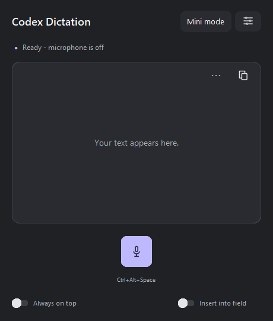

# Codex Dictation for Windows

An experimental, independent voice dictation companion for T3 Code. It streams microphone audio to the Codex voice service using your existing Codex ChatGPT sign-in, and puts the transcription in an editor or a verified original text field.

**Not an official OpenAI or T3 Code feature.** The voice integration can change or become unavailable. Account eligibility, quotas and future billing are controlled by the service; this project does not promise free or unlimited transcription.

[Download the Windows x64 portable release](https://github.com/PedroLLou/codex-dictation/releases/latest) · [Português](docs/README.pt-BR.md)



## Start using it

1. Download and extract the **entire** `codex-dictation-0.3.0-windows-x64.zip` to a writable folder. Keep all its files together. No Python installation is needed for the portable release.
2. Sign in to the official Codex CLI with your ChatGPT account (`codex login`). See [official authentication documentation](https://developers.openai.com/codex/auth/). The app does not accept an API key and does not copy your credentials into the release folder.
3. Run **Start Codex Dictation.vbs**, or `app-bin/Ditado Codex.exe`. Choose your input device under Preferences.
4. Click the microphone, speak, then click Stop. Review the text before sending it. `Ctrl+Alt+Space` toggles recording; `Esc` cancels an active recording. The shortcut is configurable; hold-to-talk is also available.
5. Optional: enable **Insert into field**, focus the desired text field, then start using the shortcut. The app sends Unicode text only after checking that the original field still has focus. It never sends Enter or automatically submits a message. If verification fails, the text remains in the editor.

The release is unsigned, so Windows may display its normal reputation warning. Check the SHA-256 checksums on the release page; do not disable antivirus. Windows 10 x64 was tested here. Windows 11 is a target, but has not been tested in this release.

## Mini mode

Mini mode is a small floating microphone, level meter and expand button. It appears over **T3 Code only while T3 is the foreground application**, including the Nightly executable. It hides when switching apps or minimizing T3 and returns at the same position without taking input focus. Drag the background to move it.

Focus the T3 input before clicking the mini microphone. Mini mode automatically attempts insertion into the original field. If focus or field identity changes, insertion is refused and the full editor returns for review. The meter is lavender during recording/processing and pink when the connection is unavailable; hover over the microphone for the status. Hiding mini mode does not cancel a recording already in progress; use the shortcut to stop/cancel it.

## Preferences and convenience

- English and Portuguese UI. Select **Language** in Preferences, save, then close and reopen. Changing the UI language never changes dictated text or dictionary rules.
- Always on top and automatic insertion controls on the main screen.
- Create a desktop shortcut from Preferences. **Start with Windows is optional and off by default**; saving that checkbox creates/removes only this app's shortcut in the current user's Startup folder.
- Session history, manual text export, optional replacement dictionary, undo for dictionary corrections, connection warm-up, and explicit recovery of retained audio after errors.
- Cancel and incomplete results never automatically insert text. Recovery is requested explicitly and stays in the editor for review.

## Privacy and isolation

The microphone opens only when recording is explicitly requested. Audio and session history are kept in memory; audio is sent to the hosted Codex voice service. The app does not automatically save recordings or transcripts. Preferences and replacement rules are stored in `userdata/settings.json`. Copying/exporting text is an explicit user action. Hosted service retention/privacy rules still apply.

The underlying remote voice session may produce assistant replies. This app discards assistant text/audio and does not play replies. A patched Codex app-server disables realtime handoff admission; the broker permits a small set of read/account/ephemeral-thread/realtime methods and aborts on unexpected local agent activity. It does not intentionally run coding turns, tools, shell commands or MCP integrations from dictated phrases. The app-server binary is checked against a build manifest before use.

This remains experimental isolation, not a formal security guarantee. See [architecture and limitations](docs/ARCHITECTURE.md). T3 Code is not patched or replaced, so this companion's files are independent of T3 updates.

## Troubleshooting

| Symptom | What to try |
| --- | --- |
| Not signed in / service disconnected | Sign in through the official Codex CLI with ChatGPT, then use Reconnect. API-key accounts are not supported. |
| Saved microphone unavailable | Reconnect it, refresh microphones and choose an available device. |
| No text / incomplete result | Review partial text or explicitly recover retained audio. Do not close the app if you need that recording: it exists only in RAM. |
| Automatic insertion refused | Keep the original editable field focused. Password fields, terminals, unknown controls and multiline automatic input are refused. Copy manually when needed. |
| Mini disappeared | Activate T3 Code again. Use the tray Show action to return to the full editor. |
| Slow first recording | A cold voice connection takes longer. Optional warm-up prepares the connection with the microphone off and expires after the configured idle period. |
| Hotkey conflict | Change the shortcut in Preferences or use the microphone button. |

## Development and verification

Python 3.13 x64, Windows, a task-local virtual environment, and dependencies pinned in `requirements-lock.txt`:

```powershell
py -3.13 -m venv .venv
.\.venv\Scripts\python.exe -m pip install -r requirements-lock.txt
.\.venv\Scripts\python.exe -m unittest discover -v
```

Download the release to obtain the validated `target/release/codex-app-server.exe`, or build it from the exact upstream revision with `build-codex.ps1`. It requires Git, Rust 1.95.0 and Windows native build tools. Use a short source path. The complete modification is in `patches/codex-dictation.patch`.

`build-desktop.ps1` packages the interface and the native service into `dist/app-bin`. `package_release.py` assembles a release using an explicit file allowlist, without user data, login credentials or development logs. Source mode uses `.venv`; the portable build has a bundled runtime.

Offline tests cover queue bounds, cancellation, stale/duplicate results, recovery state, dictionary rules, settings, translations, packaged paths and original-focus safety. `validate_windows.py` checks native UI Automation, tray, mutex and shortcut lifecycle. `validate_input.py` inserts synthetic Unicode into its own native Edit control and checks that changing focus blocks insertion. It never writes into T3 or another app.

`app-bin/Ditado Codex.exe --validate-packaged` is an **optional online test**: it sends the included synthetic WAV to the voice service, verifies a transcription and recovery, and writes a validation report. It requires your signed-in account and can consume service quota; it never opens the microphone. Results are documented in [validation](docs/VALIDATION.md).

Actual microphone quality, long sessions, all network failures and every T3 input/focus pattern cannot be guaranteed by these tests. Review output and report reproducible issues without uploading credentials or private recordings.

## License and dependencies

App source and Codex patch: Apache-2.0. OpenAI Codex notices and third-party license texts are included under `third-party/`. FFmpeg shared libraries and pystray have separate LGPL terms; dependency source references and rebuild information are in `third-party/SOURCES.md`. You may replace/rebuild those libraries; this app does not restrict reverse engineering for that purpose.
